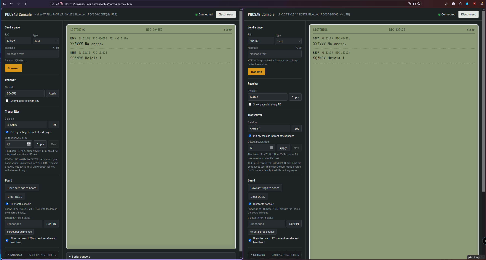

# lora-pocsag
70cm LoRA as POCSAG pager


**[Open the web console](https://sq5nry.github.io/lora-pocsag/webui/pocsag_console.html)** to connect to a board over USB or Bluetooth (Chrome or Edge; on Android use Bluetooth).



## Firmware

One Arduino sketch, `pocsag_fw/`, for both boards (and a home-made E22 board, see below). The
board profile follows the board chosen in the Arduino IDE: *TTGO LoRa32-OLED* → LilyGO T3 V1.6.1
(SX1278), *Heltec WiFi LoRa 32(V3)* → Heltec V3 (SX1262), *ESP32 Dev Module* → ESP32 DevKit + E22
(SX1268). To force one, uncomment its line at the top of `pocsag_fw/board.h`. The board name is
shown on the display and serial at start-up.

1. Arduino IDE with the **esp32 by Espressif** board package.
2. Libraries from the Library Manager: **RadioLib**, **U8g2**, **NimBLE-Arduino** (2.x).
3. Board: *TTGO LoRa32-OLED* for the T3, *Heltec WiFi LoRa 32(V3)* for the Heltec, *ESP32 Dev Module* for the E22.
   If uploads fail, lower the upload speed to 460800 or 115200.
4. Open `pocsag_fw/pocsag_fw.ino` and upload.

After the first start, set your callsign and RIC (web console, or serial at 115200 baud):

```
/call YOURCALL
/ric 1234567
/save
```

Type `/help` for all commands: frequency correction and carrier for calibration, receive filter
width, transmit power and time limit, monitor mode for all RICs, stored pages, Bluetooth, DAPNET.

### ESP32 DevKit + Ebyte E22-400M30S (1 W)

A third, home-made board: an ESP32-WROOM DevKit with an E22-400M30S module (SX1268 with a
1 W PA and an LNA), wired as the Meshtastic DIY "E-byte Type 1" schematic with one change.

| E22 pin | ESP32 | |
|---|---|---|
| 19 NSS | IO18 | |
| 18 SCK | IO5 | |
| 17 MOSI | IO27 | |
| 16 MISO | IO19 | |
| 15 NRST | IO23 | |
| 14 BUSY | IO32 | |
| 13 DIO1 | IO33 | interrupt |
| 6 RXEN | IO14 | LNA path, switched by the firmware |
| 7 TXEN | – | **bridged to pin 8 (DIO2)**, not to an ESP32 pin |
| 9, 10 VCC | +5 V | full power needs 5 V and about 0.6 A |
| GND | GND | |

With TXEN on DIO2 the SX1268 turns its PA on by itself only while it transmits, so a firmware
hang can never leave the PA keyed. The OLED (SSD1306, I²C) goes on SDA IO21 / SCL IO22.

Build it with the board set to *ESP32 Dev Module*; that selects the E22 profile. The power setting (−9…22 dBm) is the
SX1268 output; the PA adds about 8 dB, so 22 gives about 1 W. Never transmit without an antenna.

If the display shows `ERR radio init: -2` (chip not found), the firmware reads the chip's
version register by hand and shows the result:

- `BUSY ... STUCK` – BUSY or NRST wiring, or the module has no supply
- `00 00 00 00` – module unpowered or MISO held low
- `FF FF FF FF` – MISO open, or NSS not reaching the module
- `SX1268 ...` – the chip answers; check the wiring of the other SPI lines and BUSY

If the chip is found but init still fails, set `TCXO_VOLTAGE` to `0` in `board.h`.

### DAPNET

The board can work as a DAPNET transmitter: it logs into the DAPNET core over WiFi and sends the
pages DAPNET routes to it, in the time slots DAPNET assigns (16 slots of 6.4 s; the clock comes
from NTP). Local pages from the console still go out at once.

1. Register at [hampager.de](https://hampager.de) (amateur licence needed): a user account with
   your RIC, and a **transmitter** (support ticket "New DAPNET Transmitter"; a home node is type
   *personal*). You get a transmitter name and an **auth key** – not your user password.
2. In the web console, *Board → DAPNET*: WiFi network and password, transmitter name, auth key,
   then tick *Relay pages from DAPNET* and *Save settings to board*. Or over serial:

   ```
   /wifi MyNetwork|wifi-password
   /dapnet name sq5nry
   /dapnet key <auth key>
   /dapnet 1
   /save
   ```

3. `/dapnet` shows the link state; the console shows it live: online, assigned slots, pages
   received / sent / waiting. Relayed pages show up in the message list as *SENT via DAPNET*.

Pages longer than the transmit time limit (`/txmax`) are dropped, and DAPNET time broadcasts
older than 15 s are skipped, as DAPNETGateway does. If the T3 or E22 build is too big for flash
with WiFi and Bluetooth together, pick *Tools → Partition Scheme → Minimal SPIFFS* (or *Huge APP*).

A transmitter that others use is still your station: it has to run under your licence and the
rules for your country. In Poland a small home hotspot is usually run under the personal licence;
a wide-area transmitter left unattended (e.g. the 1 W E22 on a mast) normally needs its own UKE
permit for an unattended station. Check before going on air.

### Matching the frequency of two boards

Crystal boards (like the T3) can be several kHz off, while POCSAG between two boards stops
working at roughly 3 kHz of difference. To align a board to a reference (ideally the Heltec,
which has a TCXO): on the board to tune run `/calsync` (or *Tune to another board* in the web
console's Calibration panel), then on the reference run `/calbeacon` (*Send calibration signal*).
The boards briefly switch to LoRa, whose receiver measures the frequency error of each packet;
the tuned board corrects itself in a few rounds to within about 100 Hz. Save with `/save`.

The Heltec V3 must be the 433/470–510 MHz variant; the 868/915 MHz board is matched for that band.
